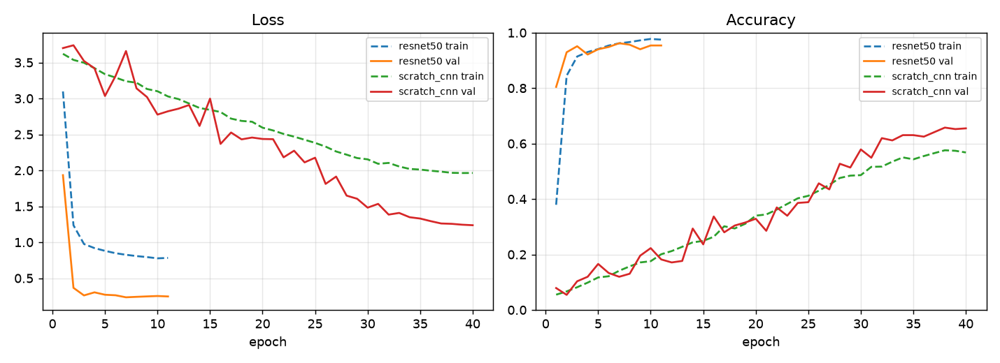
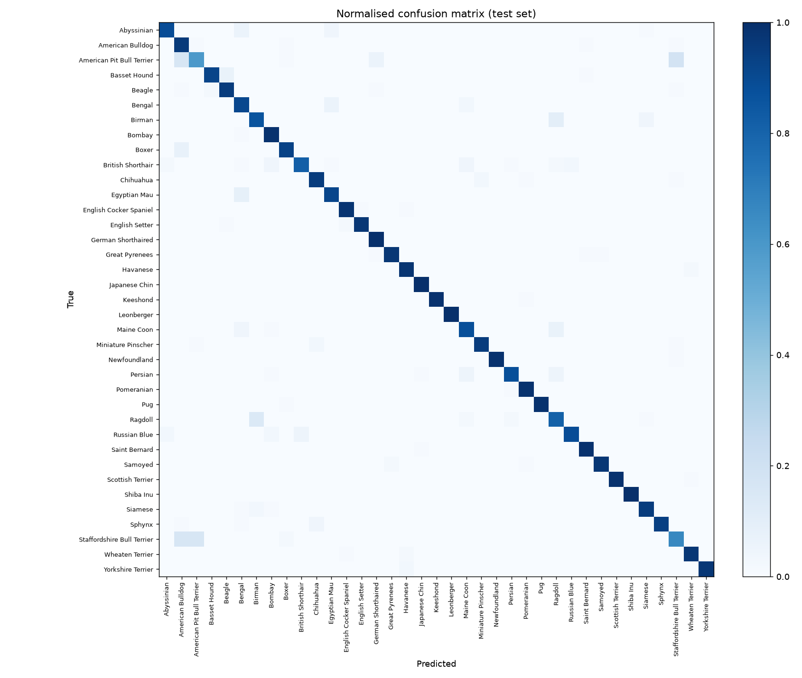
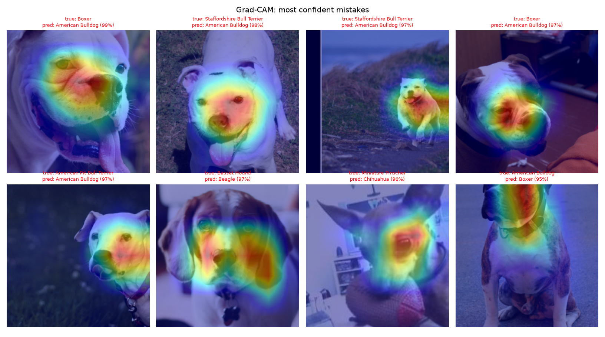
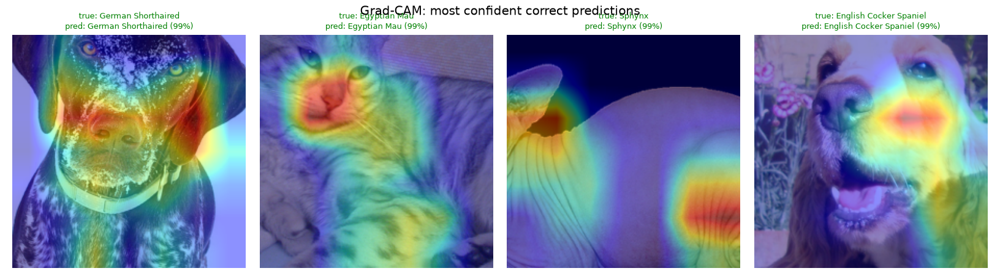
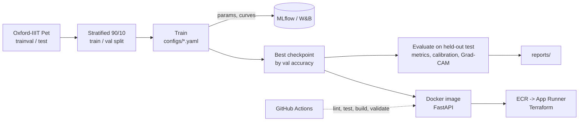

# Pet Breed Classifier: an end-to-end MLOps pipeline

[](https://github.com/juhidixit/pet-classifier-mlops/actions/workflows/ci.yml)


Fine-grained image classification of **37 cat and dog breeds** (Oxford-IIIT Pet), built the way a
production ML team would: reproducible configs, experiment tracking, hyper-parameter sweeps,
tested code, explainability, a containerised API, CI, and infrastructure-as-code.

The core question: **how much does transfer learning buy you on a small, fine-grained dataset,
and is the better model right for the right reasons?** An ImageNet-pretrained ResNet-50 is
compared against a CNN trained from scratch under the identical data pipeline, then both are
dissected with Grad-CAM, calibration and error analysis.

## Results

Measured on the official Oxford-IIIT Pet **test split (3,669 images, 37 breeds)**, never used for
training or model selection. Trained on an Apple M2 (8 GB, MPS) with the shipped configs and no
overrides; checkpoints chosen by validation accuracy. Test-time augmentation: horizontal flip.

| Model | Params | Test top-1 | Test top-5 | Macro-F1 | ECE | Cat vs dog acc. | Epochs | Train time |
|---|---|---|---|---|---|---|---|---|
| **ResNet-50 (ImageNet transfer)** | 23.6M | **93.0%** | 99.5% | 0.929 | 0.094 | 99.8% | 11 (early stop) | 159 min |
| Scratch CNN (random init) | 4.7M | 60.0% | 91.3% | 0.592 | 0.112 | 93.6% | 40 | 121 min |

**Transfer learning adds 33 accuracy points** (93.0% vs 60.0%) and cuts breed errors from 1,467
to 256. With only ~3,300 training images, a from-scratch network cannot learn features that
ImageNet pre-training already provides. Learning curves: [reports/learning_curves.png](reports/learning_curves.png).



### Error analysis (ResNet-50)
* **Mistakes are fine-grained, not gross:** of 256 errors, only **7** confuse a cat with a dog;
  249 are the wrong breed of the right species. The scratch CNN makes 236 cross-species errors.
* **Hardest breeds:** American Pit Bull Terrier (59% accuracy), Staffordshire Bull Terrier (66%),
  Ragdoll (81%), British Shorthair (82%), Birman (86%).
* **Most confused pairs:** Pit Bull -> Staffordshire (18), Pit Bull -> American Bulldog (16),
  Staffordshire -> Pit Bull (14), Ragdoll <-> Birman (14 / 10). These are breeds that even
  experts distinguish mainly by registry papers, so many "errors" are near label noise.
* **Confident mistakes:** the most confident wrong predictions (about 97-99%) are Boxers and
  Staffordshire Terriers labelled American Bulldog.
* **Calibration:** ECE 0.094. Label smoothing and mixed augmentation make the model *under*-confident
  on its correct predictions; temperature scaling would be the natural next step.

| Confusion matrix | Grad-CAM: confident mistakes | Grad-CAM: confident hits |
|---|---|---|
|  |  |  |

More figures per run: `reports/<run>/` (reliability diagram, per-class accuracy, `metrics.json`
with every number above, `history.json` with per-epoch curves).

### Honest caveats
* Single seed, single run per model; no confidence intervals. The 33-point gap is far outside any
  plausible seed noise, but the exact decimals are not.
* The scratch CNN is a deliberately small baseline at 160 px with a modest 40-epoch budget; a
  heavily tuned from-scratch network with longer training would score higher.
* These two runs predate the MLflow fix (the installed MLflow rejected the `file:` store), so their
  curves live in `reports/<run>/history.json`, not in an MLflow UI. Current configs log to a local
  SQLite MLflow store (`make mlflow-ui`). The W&B sweep config is provided but has not been run.
* Terraform is validated (`terraform validate`), never applied; no cloud resources exist.


## What's inside

```
pet-classifier-mlops/
├── src/petcls/            # the library
│   ├── config.py          # typed YAML configs + `section.key=value` CLI overrides
│   ├── data.py            # transforms, leakage-free stratified val split, cat/dog taxonomy
│   ├── models.py          # ResNet-50 (transfer) and ScratchCNN (baseline), checkpoint I/O
│   ├── engine.py          # train loop, AMP, grad clipping, warm-up + cosine LR, TTA inference
│   ├── train.py           # two-stage fine-tuning, early stopping, MLflow / W&B logging
│   ├── evaluate.py        # test metrics, calibration, error analysis, Grad-CAM galleries
│   ├── gradcam.py         # Grad-CAM from scratch (hooks), overlays, attention-in-box score
│   ├── metrics.py         # top-k, macro-F1, ECE, reliability curve, most-confused pairs
│   └── predict.py         # single-image inference + explanation (shared by API and demo)
├── serve/app.py           # FastAPI: /predict, /explain (Grad-CAM PNG), /health, /metrics
├── demo/streamlit_app.py  # upload a photo -> breed + "why" heatmap
├── configs/               # resnet50, scratch_cnn, smoke (CI), W&B Bayesian sweep
├── infra/terraform/       # AWS: ECR, versioned S3 artifact store, IAM, App Runner autoscaling
├── tests/                 # 29 tests: config, data, models, Grad-CAM, metrics, API, end-to-end
├── reports/               # generated metrics + figures for each run
├── Dockerfile             # slim, non-root, healthchecked CPU inference image
└── .github/workflows/ci.yml  # lint -> tests (3.10, 3.12) -> docker build + live API check -> terraform validate
```

## Pipeline



### Training recipe
* **ResNet-50 (transfer):** ImageNet V2 weights, new dropout + linear head. Stage 1 trains only
  the head for one epoch so random head gradients don't wreck pretrained features; stage 2
  unfreezes everything with a **discriminative learning rate** (backbone = 0.1 x head).
* **ScratchCNN (baseline):** 10 conv layers with BatchNorm and global average pooling,
  4.7M parameters, Kaiming init, trained from random weights.
* **Shared:** AdamW, label smoothing 0.1, linear warm-up then cosine decay, TrivialAugment +
  random-resized-crop + random erasing, gradient clipping, mixed precision on CUDA, early stopping
  on the validation split, horizontal-flip test-time augmentation at evaluation.
* **No leakage:** the validation split is carved out of `trainval` (stratified, seeded); the
  official `test` split is touched exactly once, by `evaluate.py`.

## Quick start

```bash
git clone https://github.com/juhidixit/pet-classifier-mlops && cd pet-classifier-mlops
python -m venv .venv && source .venv/bin/activate
pip install -r requirements.txt          # torch auto-detects CUDA / Apple MPS / CPU

make test                                # 29 tests, no downloads
make smoke                               # synthetic end-to-end run in seconds
make train-all                           # train both models, evaluate, build results table
make mlflow-ui                           # browse runs at http://localhost:5000 (SQLite store)
```

Any config value can be overridden from the command line:

```bash
python -m petcls.train --config configs/resnet50.yaml train.lr=3e-4 train.epochs=20 model.dropout=0.4
```

### Hyper-parameter sweep (Weights & Biases)

```bash
wandb login
wandb sweep configs/sweep.yaml            # Bayesian search over lr, backbone LR multiplier,
wandb agent <entity>/<project>/<sweep-id> # weight decay, label smoothing, dropout, batch size
```

### Serve it

```bash
make serve                                # FastAPI on :8000, docs at /docs
curl -F "file=@my_dog.jpg" "localhost:8000/predict?k=3"
curl -F "file=@my_dog.jpg" "localhost:8000/explain" -o why.png   # Grad-CAM overlay

make docker && make docker-run            # same API in a container
make demo                                 # Streamlit UI with prediction + heatmap
```

### Deploy (AWS)
`infra/terraform` provisions ECR, a versioned and encrypted S3 artifact bucket, an IAM role, and
an autoscaling App Runner service with health checks. See
[infra/terraform/README.md](infra/terraform/README.md). CI runs `terraform validate` only; nothing
is applied automatically.

## Model card
See [MODEL_CARD.md](MODEL_CARD.md) for intended use, data, metrics, limitations and ethical notes.

## License
MIT
